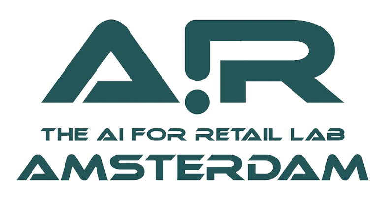

# Serenade — Scalable Session-Based Recommendations

[](https://crates.io/crates/serenade)
[](https://crates.io/crates/serenade)
[](https://github.com/bolcom/serenade/LICENSE.md)
[](https://github.com/bolcom/serenade/actions/workflows/release.yml)
[](https://docs.rs/serenade)
[](https://github.com/bolcom/serenade/graphs/contributors)

[](https://icai.ai/airlab/)
[](https://irlab.science.uva.nl/)

Serenade is an open-source, high-performance session-based recommendation system developed through academic research in collaboration between **[bol.com](https://www.bol.com/) and the [University of Amsterdam (AIRLab)](https://icai.ai/airlab/)**. The system was introduced in our [**SIGMOD 2022 paper, *Serenade: Low-Latency Session-Based Recommendation in e-Commerce at Scale***](https://doi.org/10.1145/3514221.3517901).

The research introduces two complementary contributions:

VMIS-kNN — Scalable recommendation algorithm. An efficient adaptation of the state-of-the-art VS-KNN algorithm. VMIS-kNN introduces specialized indexing data structures and an optimized neighbor retrieval algorithm using bounded candidate selection and early stopping. With fixed retrieval parameters, the computational complexity of candidate retrieval depends on the length of the evolving session rather than the size of the historical training corpus, enabling low-latency recommendations across billions of interactions.

Serenade — Production recommendation system. A scalable, stateful recommendation service built around VMIS-kNN, combining real-time session management, low-latency recommendation serving, and efficient resource utilization. Originally deployed at bol.com, Serenade demonstrates that high-quality session-based nearest-neighbor recommendations can operate at industrial scale with low latency and modest computational resources.

## Optimize, evaluate, serve

Download and extract a [release](https://github.com/bolcom/serenade/releases).
Windows packages contain `.exe` files; Linux and macOS use the same names without
`.exe` (prefix commands with `./`). The spelling `tpe_hyperparameter_optm` is intentional.

**1. Optimize**

```powershell
.\tpe_hyperparameter_optm.exe --config workspace/hpo.toml
```

**2. Evaluate and optionally benchmark**

```powershell
.\evaluator.exe --model workspace/best-vmis.toml --model workspace/best-wsknn.toml --benchmark
```

**3. Serve**

```powershell
.\serving.exe --model workspace/best-vmis.toml --config workspace/serenade.toml
```

The release includes a ready-to-run `workspace/` with `train.txt`, `validation.txt`,
`test.txt`, `hpo.toml`, and `serenade.toml`. A workspace is just a directory convention.
HPO writes `best-<algorithm>.toml` for every enabled algorithm beside `hpo.toml`.
These portable files contain only model parameters. HPO uses training and validation
sessions; it never opens the test set. Trial diagnostics are optional (`save_records`).

`hpo.toml` owns search spaces, objective/cutoff, trials, seed, evaluation workers and
independent `[data] index_capacity`. `serenade.toml` owns host, port, worker count,
business filters and independent index capacity. It contains no optimized parameters.
The example server listens on port 8081.

Dataset defaults follow the configuration: HPO finds training and validation data
beside `hpo.toml`; evaluation finds training and test data beside the supplied models;
serving finds training data beside its model, even when its serving configuration
is in another directory. Config-file paths resolve relative to their containing
file; CLI paths resolve relative to the current working directory. Absolute paths
and quoted paths with spaces work, including on separate storage volumes.

Evaluation accepts repeated `--model` arguments, including multiple versions of
one algorithm. It writes `evaluation.csv`, or `benchmark.csv` with `--benchmark`,
beside the models. Models from different directories require `--dataset-dir DIR`
(which also sets the default output directory), or both `--train FILE --test FILE`
and `--output FILE`. It never chooses the first model's dataset in that case.

Advanced overrides: HPO accepts `--train`, `--validation`, `--output` (directory),
`--algorithm`, and `--index-capacity`. Evaluation accepts `--dataset-dir`, `--train`,
`--test`, `--output` (CSV), `--index-capacity`, `--workers`, and `--business-logic true|false`.
Serving accepts `--train` or `--index`; `[data] training_data_path` and `index_path`
in `serenade.toml` provide configuration-relative overrides. None requires copying
production data. All three use independent index capacity 2500 by default and reject
incompatible retrieval limits. Persisted indexes must already support that capacity.

Quality evaluation preserves all eight metrics at 20, reusing matching training
indexes and test data. Benchmarking preserves median aggregation, separate serial
latency and parallel throughput, with `--iterations 5`, `--warmup 1`, and optional
`--snapshot-dir DIR` for snapshot save/load measurements. HPO retains shared immutable
data, objective-only parallel evaluation, reusable worker buffers and sequential TPE trials.

For source builds, use `cargo run --release --bin NAME -- ARGS`. Extract
`assets/example/example.zip` into `workspace/` for the same example workflow.
See [configuration details](docs/CONFIG.md) and [data preparation](docs/Preparation.md).

## Performance at scale

Our research demonstrates that session-based nearest-neighbor methods can achieve **millisecond-level prediction latency at industrial scale**, even in large e-commerce environments.

- **Under 1.7 ms p90 prediction latency** in microbenchmarks using datasets of up to 60 million interactions and 1.76 million distinct items.
- **1,000 recommendations per second** served using just two vCPUs.
- **Under 7 ms p90 end-to-end latency** in a Kubernetes production deployment, including network overhead, session retrieval from RocksDB, business-rule filtering, and response serialization.
- **2.3 billion historical interactions** processed, with 582 million retained after index pruning, covering approximately 6.5 million distinct products.
- **Approximately 11 GB of index memory** per serving instance at this production scale.

These results demonstrate how carefully designed algorithms and data structures can make session-based nearest-neighbor recommendation practical at massive scale.

*These performance figures originate from the original SIGMOD 2022 research and production deployment of VMIS-kNN. They do not represent benchmark results for all algorithms supported by the extended Serenade implementation.*

## Extending Serenade with additional scalable kNN algorithms

Building on the original VMIS-kNN research, **we extend Serenade with scalable adaptations of six established session-based kNN algorithms**, preserving their distinctive scoring methods while leveraging VMIS-kNN's efficient neighbor retrieval architecture.

| Algorithm | Paper | Publication |
|---|---|---|
| **SKNN** | [When Recurrent Neural Networks meet the Neighborhood for Session-Based Recommendation](https://doi.org/10.1145/3109859.3109872) | RecSys '17 |
| **S-SKNN (SeqContextKNN)** | [Evaluation of session-based recommendation algorithms](https://doi.org/10.1007/s11257-018-9209-6) | UMUAI '18 |
| **WSKNN** | [WSKNN: Weighted session-based KNN algorithm for next-item recommendation](https://doi.org/10.21105/joss.05639) | JOSS '23 |
| **VS-KNN** | [Evaluation of session-based recommendation algorithms](https://doi.org/10.1007/s11257-018-9209-6) | UMUAI '18 |
| **STAN** | [Sequence and Time Aware Neighborhood for Session-based Recommendations: STAN](https://doi.org/10.1145/3331184.3331322) | SIGIR '19 |
| **VSKNN-STAN (VSTAN)** | [Empirical analysis of session-based recommendation algorithms: A comparison of neural and non-neural approaches](https://doi.org/10.1007/s11257-020-09277-1) | UMUAI '21 |

As described in [Illoominate (Kersbergen et al., 2026)](https://doi.org/10.1145/3828670), session-based kNN-based recommendation can be decomposed into two functions: neighbor retrieval ($f_{ret}$) and item scoring ($f_{pred}$).

**Our contribution is to introduce scalable adaptations of established session-based kNN algorithms by leveraging the VMISIndex for neighbor retrieval, while preserving their distinctive similarity and item scoring functions.** Through bounded, recency-ordered indexing and early stopping, neighbor retrieval scales with the length of the active session rather than the size of the historical session corpus, given fixed retrieval limits.

## What Serenade offers

Serenade provides a complete workflow for developing, evaluating, and serving session-based nearest-neighbor recommendation models:

- **Scalable recommendation algorithms:** Seven kNN approaches using the shared VMIS indexing and candidate retrieval approach.
- **Automated hyperparameter optimization:** [Tree-structured Parzen Estimator (TPE) optimization](https://proceedings.mlr.press/v28/bergstra13.pdf) across selected algorithms, with configurable objectives such as `mrr@20`, `ndcg@8`, and `hitrate@10`.
- **Offline evaluation:** Evaluate optimized models on held-out data using ranking and recommendation quality metrics.
- **Low-latency serving:** An HTTP recommendation service with session management backed by RocksDB.
- **Ready-to-run binaries:** Windows, Linux, and macOS executables, without requiring Rust or a local build environment.

The intended workflow is straightforward:

**TPE hyperparameter optimization → Offline evaluation (with optional benchmarking) → Real-time serving**

Each optimized algorithm produces a single configuration file that can be used directly by both the evaluator and serving applications.

## Request recommendations

After starting serving:

```sh
curl "http://localhost:8081/v1/recommend?item_id=13598&session_id=example&user_consent=true"
```

Use `curl.exe` in Windows PowerShell. The [internal page](http://localhost:8081/)
and [Prometheus metrics](http://localhost:8081/internal/prometheus) are available
while serving runs.

### 5. Retrieve recommendations using Python

Install the `requests` package with `python -m pip install requests`, then run:

```python
import requests
from requests.exceptions import HTTPError

try:
    myurl = 'http://localhost:8081/v1/recommend'
    params = dict(
        session_id='144',
        user_consent='true',
        item_id='13598',
    )
    response = requests.get(url=myurl, params=params, timeout=10)
    response.raise_for_status()
    # Access JSON content.
    json_response = response.json()
    print(json_response)
except HTTPError as http_err:
    print(f'HTTP error occurred: {http_err}')
except Exception as err:
    print(f'Other error occurred: {err}')
```

Example response (the items and list length depend on the dataset, algorithm, configuration, and session history):

```json
[2835,10,12068,4313,3097,8028,3545,7812,17519,1164,17935,1277,13335,8655,14664,14556,6868,13509,9248,2498,11724]
```

The returned JSON array is a list of recommended item IDs.

For more details, see [Binary packages](docs/BINARIES.md), [Configuration](docs/CONFIG.md), and [Data preparation](docs/Preparation.md).

## Research and citation

If you use Serenade in academic work, please cite the original research:

**Barrie Kersbergen, Olivier Sprangers, and Sebastian Schelter.** *Serenade: Low-Latency Session-Based Recommendation in e-Commerce at Scale.* Proceedings of the 2022 International Conference on Management of Data (SIGMOD '22), pp. 150–159.

[Read the paper](https://doi.org/10.1145/3514221.3517901)

```bibtex
@inproceedings{Kersbergen2022SerenadeScaleVMIS,
  author    = {Kersbergen, Barrie and Sprangers, Olivier and Schelter, Sebastian},
  title     = {Serenade - Low-Latency Session-Based Recommendation in e-Commerce at Scale},
  booktitle = {Proceedings of the 2022 International Conference on Management of Data},
  year      = {2022},
  pages     = {150--159},
  publisher = {Association for Computing Machinery},
  doi       = {10.1145/3514221.3517901}
}
```

## Contributing

Contributions to Serenade are welcome, including improvements to recommendation algorithms, scalability, evaluation, and serving capabilities.

## License

Serenade is licensed under the [Apache License 2.0](LICENSE.md).
